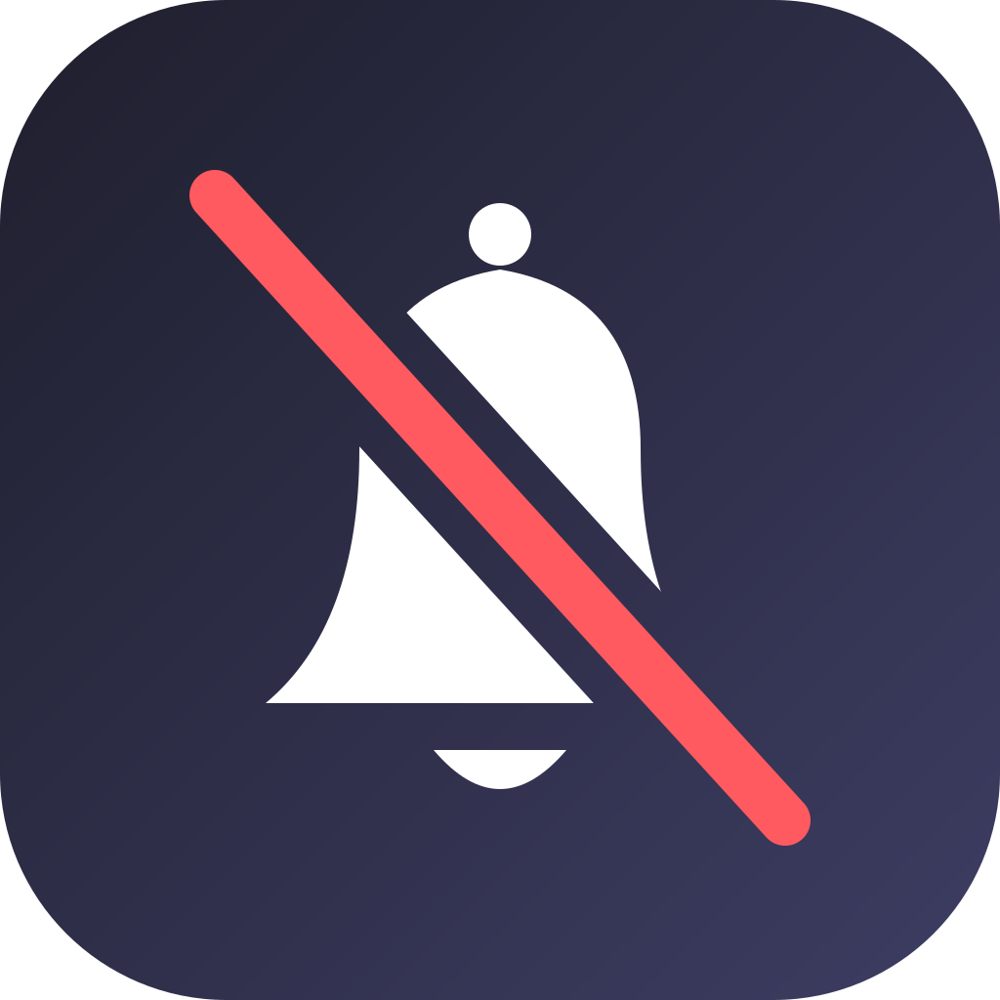

<p align="center">
  
</p>

# NotiFilter

<p align="center"><strong>NotiFilter is a rootless iOS 18 jailbreak tweak that filters notifications by app, content, and schedule.</strong></p>

- Package: `com.burc334.notifilter`
- Version: `1.0.1`
- Tested: iOS 18.4.1 (Dopamine 3, roothide) on iPhone 11 Pro Max
- Builds: rootless (`iphoneos-arm64`) and roothide (`iphoneos-arm64e`)
- License: MIT

## Compatibility

| Build | Architecture | Compatibility |
|---|---|---|
| roothide | `iphoneos-arm64e` | Tested on iOS 18.4.1 (Dopamine 3, roothide) |
| rootless | `iphoneos-arm64` | Expected to work on iOS 18+ rootless jailbreaks |

NotiFilter requires iOS 18.0 or later and targets SpringBoard notifications. The rootless build is expected to work on iOS 18+ rootless jailbreaks.

## What it does

- Filters notifications by app, or across all apps.
- Matches title, subtitle, message, or all text.
- Match modes: Contains, Starts With, Ends With, Exact, Regex, and Always.
- Actions: Block, Mute, and Allow.
- Allow overrides Block and Mute; Block overrides Mute.
- Schedules with Monday–Sunday weekdays, start and end times, and overnight windows.
- Critical alerts are never filtered.
- Blocked-notification history with configurable count and day limits.
- Versioned JSON import/export with Merge and Replace flows.
- Native preference pane with no respring required for settings changes.

## Actions

- **Block** drops the notification before it is presented. Only hard Block decisions are recorded in History.
- **Mute** keeps the notification in Notification Center while suppressing sound, display wake, and lock-screen alerting.
- **Allow** is an exception rule. A matching Allow filter overrides matching Block and Mute filters.
- **Critical alerts** bypass filtering entirely.

## Schedules

Each filter can have a schedule using Monday–Sunday weekdays and a start and end time. A schedule that crosses midnight uses the selected start day; for example, a Monday 22:00–07:00 window runs through Tuesday morning. Equal start and end times are inactive.

## History

History records only hard Block decisions. It never records Mute or Allow decisions and does not show app icons.

- History Limit: 25, 50, 100, 250, or 500 entries; default 100.
- Keep For: 1, 3, 7, 14, or 30 days; default 30.
- Clear History requires confirmation.

History is stored locally in the NotiFilter preference domain. NotiFilter does not use analytics or contact remote services.

## Import and export

Filters can be exported as versioned JSON and imported from a file. Merge is the default import action and updates filters by UUID while keeping unrelated filters. Replace removes all existing filters and requires a second confirmation.

## How it works

NotiFilter evaluates filters in the notification pipeline before presentation. Hard Block decisions stop non-critical bulletins at the BulletinBoard layer, with a dispatcher fallback. Mute preserves the Notification Center entry while disabling sound, display wake, and lock-screen alerting. Critical alerts are allowed before filter evaluation, and an unknown critical state fails open.

## Install

### Sileo

Add `https://burc334.github.io/apt/` in Sileo, then install NotiFilter.

### Manual

1. Download the deb matching your jailbreak from the latest GitHub release:
   - roothide: `com.burc334.notifilter_1.0.1_iphoneos-arm64e.deb`
   - rootless: `com.burc334.notifilter_1.0.1_iphoneos-arm64.deb`
2. Install it with Sileo, Zebra, or Filza.
3. Respring after installation so SpringBoard loads the tweak and preference bundle.
4. Open **Settings → NotiFilter**, enable NotiFilter, and add your filters.
5. Tap **Apply** after changing settings. No respring is required for settings changes.

## Build

```sh
export THEOS=$HOME/theos
make clean package FINALPACKAGE=1
./tools/make-roothide.sh
```

The rootless deb is written to `packages/`. The roothide script converts the latest rootless package to `iphoneos-arm64e`.

## Verification

SHA-256 checksums are published in `SHA256SUMS.txt` with the GitHub release. Verify the downloaded deb before installing it.

## Support

Open an issue on the [GitHub repository](https://github.com/burc334/NotiFilter/issues). Include your iOS version, jailbreak, device model, and NotiFilter version.

## License

MIT

AI-assisted development with DeepSeek-V4.1-Flash-1017.
